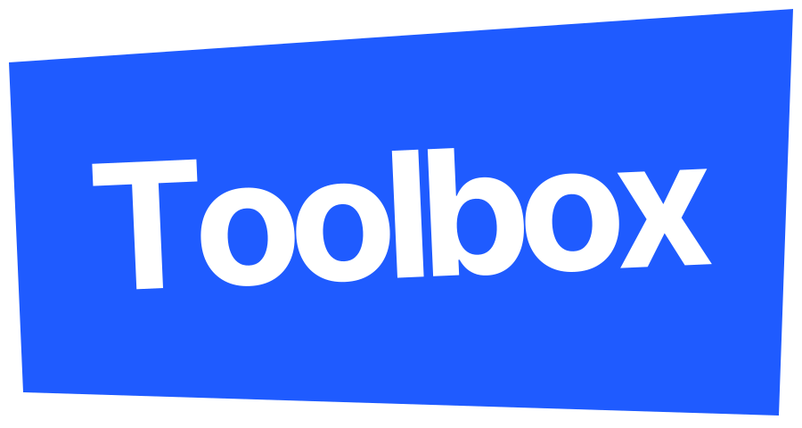

  

# Toolbox

**Arrêtez de collectionner les outils IA. Commencez à vous en servir.**

Ce mois-ci, vous avez testé six outils IA et vous en avez gardé deux, sans trop savoir pourquoi ceux-là. Ce dépôt sert à répondre à cette question.

Je range ici ce que j'ai testé moi-même : les liens que je rouvre, les tutos que j'aurais aimé trouver plus tôt, les prompts que je recopie chaque semaine. Tout est en français, gratuit et lisible sans compte.

## Qui écrit

Je suis Opaline, Product Designer depuis 10 ans. J'aide les entreprises à construire et déployer leur produit, en réduisant la friction, la ressaisie et la charge mentale de leurs utilisateurs. Chaque projet commence de la même façon : faire parler ceux qui utilisent le produit, avant de dessiner quoi que ce soit. Ensuite je couvre toutes les phases, de l'atelier de cadrage à la mise en production.

Je ne suis pas ingénieure. Je me suis formée à l'automatisation, au no-code et à l'IA pour tester une idée en quelques jours au lieu de plusieurs semaines. Ce dépôt, c'est le carnet de cet apprentissage.

## Partez de votre problème de la semaine

| Vous vous dites | À lire |
|---|---|
| « Je ne sais plus quel outil IA vaut le coup pour mon métier » | [La boîte à outils IA](./guides/boite-a-outils-ia.md) : sept outils, trois profils, et les recettes qui les enchaînent |
| « Je veux un pas-à-pas, pas une vue d'ensemble » | [Neuf tutoriels par profil](./tutoriels/tutoriels-par-profil.md), de Claude Code à Instagram |
| « Mon visage change à chaque image générée » | [Ressources IA générative](./guides/ressources-ia-generative.md) et mes prompts commentés |
| « Je publie tous les jours et rien ne bouge » | [Le système de contenu](./guides/strategie-contenu.md) : quoi publier, quand, et pourquoi |
| « Mon prestataire n'a pas compris ma boîte » | [Préparer un brief avec son IA](./guides/brief-projet-avec-ia.pdf), dix prompts à copier-coller |
| « Il me faut une référence UI, là, maintenant » | [La veille](./veille/) : 74 liens triés à la main |

## Pourquoi me faire confiance

Aucun lien n'est sponsorisé. Quand je recommande un outil payant, je dis aussi pour qui il ne vaut pas le coup. Exemple : j'ai commencé sur MidJourney, essayé six générateurs gratuits, puis pris un abonnement Higgsfield, et le même guide précise que cet abonnement est de trop si vous générez peu d'images.

Chaque document porte sa date de vérification et ses sources sont cliquables. Les outils IA changent vite : en cas de doute, la documentation officielle a le dernier mot.

## Le contenu en détail

### Veille

- [Ressources](./veille/ressources.md) : inspiration UI, design systems, accessibilité (21)
- [Outils](./veille/outils.md) : génération d'images et de vidéos, IA builders (39)
- [Plugins Figma](./veille/plugins.md) (6)
- [Bibliothèques](./veille/bibliotheques.md) : composants React, 3D, icônes (8)

### Tutoriels

- [Parcours par profil](./tutoriels/tutoriels-par-profil.md) : designers, équipes marketing, comptes Instagram business
- [Installer n8n avec Docker](./tutoriels/installer-n8n-docker.md) : avec les erreurs classiques et leur solution
- [Figma vers Webflow avec Relume](./tutoriels/workflow-figma-webflow-relume.md) : un site de deux pages sur des outils gratuits

### Guides

- [La boîte à outils IA](./guides/boite-a-outils-ia.md) : sept outils, trois profils
- [Ressources IA générative](./guides/ressources-ia-generative.md) : outils testés, angles photo, prompts commentés
- [Système de contenu](./guides/strategie-contenu.md) : la méthode ACRV, du premier regard à la vente
- [Brief projet avec son IA](./guides/brief-projet-avec-ia.pdf) (PDF) : dix prompts à copier-coller

### Prompts

- [Prompt maître du harnais d'agents](./prompts/prompt-maitre-harnais.md) : pour Claude Code, avec une règle de départ, ne jamais confondre « l'agent dit qu'il a réussi » avec « le système a réussi »

En ce moment, je creuse les design systems, l'accessibilité (RGAA, WCAG), la génération d'images et de vidéos, Claude Code, l'automatisation avec n8n et Airtable, la vérification des agents et la stratégie de contenu. J'en parle aussi sur [LinkedIn](https://www.linkedin.com/in/opalinemustiere/).

## Servez-vous

Tout le contenu est sous licence [CC BY 4.0](./LICENSE). Vous pouvez le copier, l'adapter, le traduire, l'intégrer à une formation ou à un livrable client, même payant, à condition de citer la source, par exemple : « Opaline, Antidote.AI, github.com/antidoteforai-netizen/Toolbox ». Le [système de contenu](./guides/strategie-contenu.md) et le [guide du brief](./guides/brief-projet-avec-ia.pdf) sont faits pour circuler : partagez-les à votre équipe ou à vos clients.

Un guide vous a fait gagner une soirée ? Une ⭐ sur le dépôt me dit quoi enrichir en premier. Pour un lien mort, une erreur ou un outil qui mérite sa place, [ouvrez une issue](../../issues).

---

*Par Opaline · Antidote.AI*
