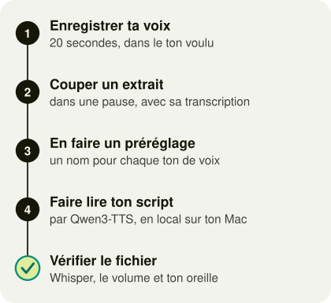

# Cloner sa voix pour ses voix off avec Qwen3-TTS

De ton enregistrement au fichier audio lu par ta voix clonée, en local sur ton Mac, gratuitement et sans quota, avec le modèle libre Qwen3-TTS. Chaque commande de ce tutoriel a été lancée et vérifiée le 3 novembre 2026.

*Mis à jour le 3 novembre 2026.*



## Sommaire

- [Avant de commencer](#avant-de-commencer)
- [01 · Installer les outils](#01--installer-les-outils-une-seule-fois)
- [02 · Préparer ton dossier de travail](#02--préparer-ton-dossier-de-travail)
- [03 · Tester avec une phrase](#03--tester-avec-une-phrase)
- [04 · Enregistrer ta voix](#04--enregistrer-ta-voix)
- [05 · Préparer l'extrait de référence](#05--préparer-lextrait-de-référence)
- [06 · Créer un préréglage](#06--créer-un-préréglage)
- [07 · Écrire le script](#07--écrire-le-script)
- [08 · Générer et vérifier ta voix off](#08--générer-et-vérifier-ta-voix-off)
- [Check final](#check-final)
- [Pourquoi Qwen3-TTS](#pourquoi-qwen3-tts)

## Avant de commencer

Il te faut un Mac à puce Apple (M1 ou plus récent), environ 8 Go libres sur le disque, [Homebrew](https://brew.sh) pour installer les outils et l'app Terminal, où se tapent toutes les commandes. Ta voix et tes textes restent sur ton Mac, puisque seul le modèle se télécharge une fois depuis Hugging Face.

> Ne clone que ta propre voix et ne dépose jamais tes enregistrements sur un site en ligne, parce qu'une voix suffit à usurper une identité.

### À la fin de ce tuto, tu sais

- installer Qwen3-TTS et Whisper sur ton Mac ;
- préparer un extrait de ta voix et sa transcription ;
- ranger chaque ton de voix dans un préréglage ;
- faire lire un script par ta voix clonée, puis vérifier le fichier obtenu.

## 01 · Installer les outils (une seule fois)

1. Installe Python 3.14 et ffmpeg, l'outil qui convertit et coupe les fichiers audio :

   ```bash
   brew install python@3.14 ffmpeg
   ```

2. Crée un Python isolé, réservé à ta voix, que tu pourras supprimer d'un geste en effaçant ce dossier :

   ```bash
   python3.14 -m venv ~/.venvs/qwen3-tts
   ```

3. Installe Qwen3-TTS, qui clone ta voix, et Whisper, qui transcrit l'audio pour vérifier ce qui est dit :

   ```bash
   ~/.venvs/qwen3-tts/bin/pip install -U qwen-tts openai-whisper
   ```

4. Vérifie que la puce du Mac est utilisable, la réponse attendue étant `True` :

   ```bash
   ~/.venvs/qwen3-tts/bin/python -c "import torch; print(torch.backends.mps.is_available())"
   ```

- [ ] La vérification répond `True`.

## 02 · Préparer ton dossier de travail

Crée le dossier `voix-off` avec un sous-dossier pour tes enregistrements et un autre pour tes essais, puis place le Terminal dedans :

```bash
mkdir -p ~/voix-off/reference ~/voix-off/essais
cd ~/voix-off
```

Le script ci-dessous fait lire un texte par ta voix. Copie-le avec le bouton **Copier**, puis tape `pbpaste > voix_clone.py` dans le Terminal, une commande du Mac qui écrit dans un fichier ce que tu viens de copier.

```python
"""Fait lire un texte par ta voix clonée avec Qwen3-TTS, en local sur ton Mac, sans compte ni quota.

Chaque ton de voix est un préréglage du fichier voix-presets.json rangé à côté de ce script : un extrait de
ta voix, sa transcription exacte, une graine (pour retrouver la même voix d'un essai à l'autre) et une vitesse.
Exemple, depuis le dossier voix-off :
  ~/.venvs/qwen3-tts/bin/python voix_clone.py --preset essai --texte "Bonjour !" --sortie essais/brique.wav
"""

import argparse
import json
import os
import pathlib
import subprocess
import time

import soundfile as sf
import torch
from qwen_tts import Qwen3TTSModel

DOSSIER = pathlib.Path(__file__).resolve().parent
PRESETS = json.loads((DOSSIER / "voix-presets.json").read_text(encoding="utf-8"))

parser = argparse.ArgumentParser(description="Ta voix clonée avec Qwen3-TTS, en local.")
parser.add_argument("--preset", required=True, choices=sorted(PRESETS), help="le ton de voix, pris dans voix-presets.json")
parser.add_argument("--texte", required=True, help="le texte à lire, ou le chemin d'un fichier .txt")
parser.add_argument("--sortie", required=True, help="le fichier .wav à écrire")
parser.add_argument("--vitesse", type=float, help="remplace la vitesse du préréglage (1.1 = 10 %% plus rapide)")
parser.add_argument("--modele", default="Qwen/Qwen3-TTS-12Hz-1.7B-Base")
parser.add_argument("--appareil", default="mps", help="mps pour la puce d'un Mac, cpu sinon (plus lent)")
args = parser.parse_args()

preset = PRESETS[args.preset]
for cle in ("ref_audio", "ref_texte"):
    if not (DOSSIER / preset[cle]).exists():
        raise SystemExit(f"Fichier introuvable pour le préréglage « {args.preset} » : {preset[cle]}")

vitesse = args.vitesse or preset.get("vitesse", 1.0)
texte = pathlib.Path(args.texte).read_text(encoding="utf-8").strip() if args.texte.endswith(".txt") else args.texte
ref_texte = (DOSSIER / preset["ref_texte"]).read_text(encoding="utf-8").strip()
torch.manual_seed(preset.get("graine", 42))

debut = time.time()
modele = Qwen3TTSModel.from_pretrained(args.modele, device_map=args.appareil, dtype=torch.bfloat16)
charge = time.time()
sons, frequence = modele.generate_voice_clone(
    text=texte, language="French", ref_audio=str(DOSSIER / preset["ref_audio"]), ref_text=ref_texte
)
fin = time.time()

sortie = pathlib.Path(args.sortie)
sortie.parent.mkdir(parents=True, exist_ok=True)
if vitesse == 1.0:
    sf.write(sortie, sons[0], frequence)
else:
    # atempo accélère la voix sans changer sa hauteur, contrairement à un simple changement de fréquence.
    brut = sortie.with_suffix(".brut.wav")
    sf.write(brut, sons[0], frequence)
    subprocess.run(
        ["ffmpeg", "-loglevel", "error", "-y", "-i", str(brut), "-af", f"atempo={vitesse}", str(sortie)],
        check=True,
        timeout=120,
        env={"PATH": os.environ.get("PATH") or "/opt/homebrew/bin:/usr/bin:/bin"},
    )
    brut.unlink()

duree = len(sons[0]) / frequence / vitesse
print(
    f"[{args.preset}] modèle chargé en {charge - debut:.0f} s, voix générée en {fin - charge:.0f} s "
    f"pour {duree:.1f} s de son (vitesse {vitesse}), dans {sortie}."
)
```

Fais de même avec le fichier des préréglages, qui ne contient pour l'instant que le préréglage `essai` : copie le bloc, puis tape `pbpaste > voix-presets.json`.

```json
{
  "essai": {
    "description": "Le test d'une phrase, pour vérifier que tout fonctionne.",
    "ref_audio": "reference/essai.wav",
    "ref_texte": "reference/essai.txt",
    "graine": 42,
    "vitesse": 1
  }
}
```

- [ ] La commande `ls` affiche `essais`, `reference`, `voix-presets.json` et `voix_clone.py`.

> Chaque fois que tu rouvres le Terminal, tape d'abord `cd ~/voix-off`, puisque toutes les commandes suivantes partent de ce dossier.

## 03 · Tester avec une phrase

Ce petit essai vérifie que toute la chaîne fonctionne avant que tu prépares ta vraie voix de référence.

1. Enregistre-toi avec l'app Dictaphone, sur ton Mac ou ton téléphone, en lisant tranquillement cette phrase : « Bonjour, je fais un essai de ma voix pour vérifier que tout fonctionne avant de me lancer. »
2. Range le fichier dans `~/voix-off/reference/` sous le nom `essai.m4a`, puis convertis-le en mono 16 kHz :

   ```bash
   ffmpeg -i reference/essai.m4a -ac 1 -ar 16000 reference/essai.wav
   ```

3. Écris la phrase lue, mot pour mot, dans sa transcription :

   ```bash
   echo "Bonjour, je fais un essai de ma voix pour vérifier que tout fonctionne avant de me lancer." > reference/essai.txt
   ```

4. Fais lire une autre phrase par ta voix clonée :

   ```bash
   ~/.venvs/qwen3-tts/bin/python voix_clone.py --preset essai --texte "Bonjour, c'est un essai de ma voix clonée." --sortie essais/brique.wav
   ```

5. Écoute le résultat avec `open essais/brique.wav`.

**🆘 Si ce point ne fonctionne pas**

| Ce que tu vois | Cause et solution |
|---|---|
| Le premier lancement est très long (93 s pour 5 s de son lors de mes essais) | Il télécharge le modèle, environ 4,5 Go, et la puce du Mac prépare ses calculs. Rien à faire, puisqu'ensuite le calcul prend environ deux fois la durée du son. |
| `SoX could not be found` et `flash-attn is not installed` | Deux outils facultatifs sont absents sur Mac. Rien à faire, la génération fonctionne quand même. |
| `Fichier introuvable pour le préréglage « essai »` | L'extrait ou sa transcription manque dans `reference/`, ou porte un autre nom : `ls reference` montre ce qui s'y trouve. |
| `can't open file '…/voix_clone.py'` | Le Terminal n'est pas dans le bon dossier : tape `cd ~/voix-off`. |

- [ ] Le fichier `essais/brique.wav` existe et tu reconnais ta voix.

## 04 · Enregistrer ta voix

Le modèle ne prend pas de consigne de style écrite, car il copie l'énergie de ton extrait : enregistre-toi donc dans le ton que tu veux entendre ensuite, en sachant que pour un ton joyeux, le sourire s'entend.

1. Installe-toi dans une petite pièce meublée (une chambre plutôt qu'une cuisine), fenêtres fermées, téléphone en mode avion.
2. Ouvre l'app Dictaphone du téléphone et tiens-le à 20 cm de la bouche, un peu de côté pour éviter les souffles.
3. Parle une vingtaine de secondes, en racontant plutôt qu'en lisant, puis fais deux ou trois prises et garde la meilleure.
4. Range-la dans `~/voix-off/reference/` sous le nom `ma-voix.m4a`.

- [ ] Le fichier `ma-voix.m4a` est dans `reference/`.

## 05 · Préparer l'extrait de référence

Le modèle a besoin d'un extrait d'une vingtaine de secondes qui finit sur une phrase complète, accompagné de sa transcription exacte.

1. Transcris ton enregistrement avec l'instant de chaque mot (au premier lancement, Whisper télécharge son modèle d'environ 460 Mo) :

   ```bash
   ~/.venvs/qwen3-tts/bin/whisper reference/ma-voix.m4a --model small --language French --word_timestamps True --output_format json --output_dir reference
   ```

2. Liste les endroits où couper, c'est-à-dire chaque pause de plus de 0,3 s après les dix premières secondes, avec tout ce qui a été dit avant elle :

   ```bash
   ~/.venvs/qwen3-tts/bin/python -c '
   import json
   mots = [m for s in json.load(open("reference/ma-voix.json"))["segments"] for m in s["words"]]
   for i in range(len(mots) - 1):
       if mots[i + 1]["start"] - mots[i]["end"] > 0.3 and mots[i]["end"] > 10:
           print(round((mots[i]["end"] + mots[i + 1]["start"]) / 2, 2), "s :", "".join(m["word"] for m in mots[: i + 1]).strip())
   '
   ```

3. Choisis une ligne entre 15 et 25 secondes dont le texte finit par un point, puis coupe à l'instant qu'elle indique. Avec une coupe à 19.95, par exemple, le fondu de sortie commence 0,1 s plus tôt, à 19.85 :

   ```bash
   ffmpeg -i reference/ma-voix.m4a -to 19.95 -af "afade=t=out:st=19.85:d=0.1" -ac 1 -ar 16000 reference/mon-ton.wav
   ```

4. Copie le texte de la ligne choisie, enregistre-le avec `pbpaste > reference/mon-ton.txt`, puis réécoute l'extrait (`open reference/mon-ton.wav`) et corrige dans ce fichier (`open -e reference/mon-ton.txt`) chaque mot que Whisper a mal entendu, en écrivant les chiffres en toutes lettres.

**🆘 Si ce point ne fonctionne pas**

| Ce que tu vois | Cause et solution |
|---|---|
| L'extrait finit sur un mot coupé | La coupe tombe au début du mot suivant : choisis une ligne dont la pause est plus longue, ou recule la coupe de quelques centièmes. |
| Whisper n'entend pas ce que tu as dit | C'est fréquent sur un début de phrase rapide, puisque lors de mes essais il a entendu « c'est ainsi qu'une joie » au lieu de « c'est avec une joie ». Ton oreille tranche, et ta version va dans le `.txt`. |
| La commande des pauses n'affiche rien | Aucune pause ne dépasse 0,3 s après dix secondes : remplace `0.3` par `0.2`, ou réenregistre en marquant les fins de phrase. |

- [ ] L'extrait finit sur une phrase complète et sa transcription correspond mot pour mot.

## 06 · Créer un préréglage

Un préréglage donne un nom à un ton de voix, si bien que tu en crées un par extrait (un ton enjoué pour les vidéos courantes et un ton posé pour les sujets sérieux, par exemple) avant de choisir le ton de chaque voix off avec `--preset`.

Copie ce fichier, qui garde le préréglage `essai` et ajoute `mon-ton`, puis tape `pbpaste > voix-presets.json` pour remplacer l'ancien :

```json
{
  "essai": {
    "description": "Le test d'une phrase, pour vérifier que tout fonctionne.",
    "ref_audio": "reference/essai.wav",
    "ref_texte": "reference/essai.txt",
    "graine": 42,
    "vitesse": 1
  },
  "mon-ton": {
    "description": "Ce que ce ton donne à l'écoute.",
    "ref_audio": "reference/mon-ton.wav",
    "ref_texte": "reference/mon-ton.txt",
    "graine": 42,
    "vitesse": 1
  }
}
```

| Champ | Rôle |
|---|---|
| `ref_audio` et `ref_texte` | L'extrait et sa transcription exacte, rangés dans `reference/`. |
| `graine` | Un nombre qui fixe le tirage au hasard du modèle, pour que deux essais restent comparables. |
| `vitesse` | `1` garde le débit de l'extrait, alors que `1.08` accélère de 8 % sans changer la hauteur de la voix. |

Pour un nouveau ton, ouvre le fichier avec `open -e voix-presets.json` et ajoute un bloc sur le même modèle, séparé du précédent par une virgule.

**🆘 Si ce point ne fonctionne pas**

| Ce que tu vois | Cause et solution |
|---|---|
| `JSONDecodeError` | Une virgule manque entre deux blocs ou traîne après le dernier, ou TextEdit a remplacé les guillemets droits par des guillemets courbes : désactive Édition › Substitutions › Guillemets intelligents, puis corrige le fichier. |

- [ ] La commande `~/.venvs/qwen3-tts/bin/python voix_clone.py --help` affiche `{essai,mon-ton}`.

## 07 · Écrire le script

1. Écris comme tu parles, en phrases liées, avec les chiffres en toutes lettres (« six virgule trois milliards ») pour que la voix ne les lise pas de travers.
2. Compte environ 2,7 mots par seconde de vidéo, ce qui laisse de la place aux pauses.
3. Copie ton texte, puis enregistre-le avec `pbpaste > essais/mon-script.txt`.

## 08 · Générer et vérifier ta voix off

1. Fais lire ton script par le préréglage voulu, en ajoutant `--vitesse 1.08` si tu veux plus de rythme :

   ```bash
   ~/.venvs/qwen3-tts/bin/python voix_clone.py --preset mon-ton --texte essais/mon-script.txt --sortie essais/ma-voix-off.wav
   ```

2. Vérifie que tout le script est dit, en comparant le fichier `essais/ma-voix-off.txt` que Whisper écrit avec ton texte :

   ```bash
   ~/.venvs/qwen3-tts/bin/whisper essais/ma-voix-off.wav --model small --language French --output_format txt --output_dir essais
   ```

3. Vérifie le volume moyen, qui doit rester proche de celui de ton extrait (lance la même commande sur `reference/mon-ton.wav` pour comparer) :

   ```bash
   ffmpeg -i essais/ma-voix-off.wav -af volumedetect -f null - 2>&1 | grep mean_volume
   ```

4. Écoute le fichier, puis signale dans la légende de ta vidéo que la voix est générée par IA.

**🆘 Si ce point ne fonctionne pas**

| Ce que tu vois | Cause et solution |
|---|---|
| Whisper ajoute à la fin une phrase de sous-titres qui n'existe pas | Il invente des mots sur le léger souffle final, qui est l'ambiance de ta pièce reproduite par le modèle. Rien à corriger dans le son, il suffit de couper ce souffle au montage. |
| La voix sonne juste mais plate | L'extrait de référence est trop calme : réenregistre-toi dans le ton voulu ([étape 04](#04--enregistrer-ta-voix)) et fais-en un préréglage ([étape 06](#06--créer-un-préréglage)). |

- [ ] Whisper retrouve tout le script, le volume reste proche de celui de l'extrait et la voix te convient à l'écoute.

## Check final

- [ ] Le test d'une phrase a fonctionné avant le premier long script.
- [ ] Tu n'as cloné que ta propre voix, et elle n'a jamais été déposée sur un site en ligne.
- [ ] La légende de chaque vidéo signale la voix générée par IA.

### Toutes les commandes, résumées

| Commande | Rôle |
|---|---|
| `cd ~/voix-off` | se placer dans le dossier de travail |
| `ffmpeg -i … -ac 1 -ar 16000 …` | convertir un enregistrement en mono 16 kHz |
| `~/.venvs/qwen3-tts/bin/whisper …` | transcrire un fichier audio |
| `~/.venvs/qwen3-tts/bin/python voix_clone.py --preset … --texte … --sortie …` | faire lire un texte par ta voix clonée |
| `~/.venvs/qwen3-tts/bin/python voix_clone.py --help` | lister tes préréglages |

## Pourquoi Qwen3-TTS

Qwen3-TTS 1.7B Base, publié par l'équipe Qwen d'Alibaba sous licence Apache-2.0 (usage commercial permis), parle français, clone une voix à partir d'un extrait et de sa transcription, et tourne sur la puce d'un Mac sans compte, sans quota ni jeton. Sur un Mac M4 de 16 Go, le calcul prend environ deux fois la durée du son produit. Les démonstrations en ligne s'arrêtent quand leur quota gratuit est épuisé, d'où l'installation locale.

Si tu préfères un service en ligne, payant, [ElevenLabs](https://elevenlabs.io) reste la référence du clonage de voix, et le guide des [ressources IA générative](../guides/ressources-ia-generative.md#studios-et-entreprises) le range parmi les studios à suivre.
